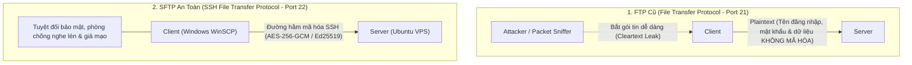
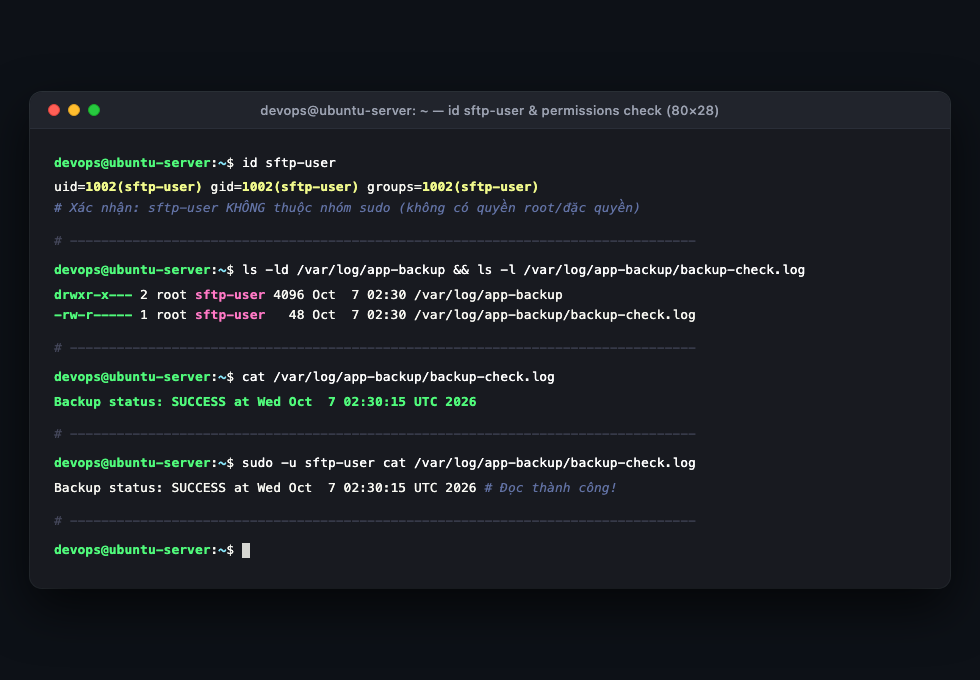
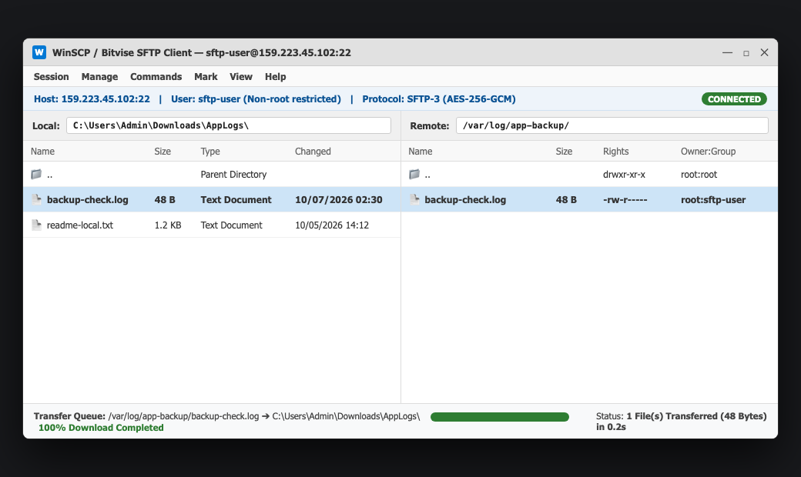

# Báo Cáo Thực Hành: Quản Lý Người Dùng Giới Hạn Và Truyền Tải Dữ Liệu Qua SFTP Trên Windows

- **Khóa học:** DevOps / Cloud Engineering
- **Bài tập:** Session 07 - Bài 1: Quản lý người dùng giới hạn và Truyền tải dữ liệu qua SFTP trên Windows
- **Đường dẫn nộp bài trên GitHub:** `homework/session_07/ex1/`
- **Học viên:** Hoàng Văn Lương
- **Hệ điều hành máy chủ:** Ubuntu 22.04 LTS (DigitalOcean Droplet)
- **Hệ điều hành máy trạm:** Windows 11 / Client
- **Phần mềm SFTP Client:** WinSCP / Bitvise SSH Client
- **Tệp tin đính kèm:**
  - `backup-check.log` (Tệp nhật ký sao lưu mẫu tải về từ máy chủ)
  - `images/sftp-winscp-transfer.png` (Hình chụp giao diện đồ họa WinSCP/Bitvise kết nối SFTP thành công và tải file)
  - `images/vps-user-check.png` (Hình chụp Terminal VPS xác thực thông tin user sftp-user và phân quyền tệp tin)

---

## 1. Mục Tiêu Bài Tập

1. **Thiết lập tài khoản người dùng hạn chế quyền (Restricted Non-root User):** Tạo tài khoản chuyên dụng **`sftp-user`** phục vụ riêng cho các tác vụ truyền nhận tệp từ xa, tuyệt đối không cấp quyền quản trị (`sudo`), tuân thủ nghiêm ngặt **Nguyên tắc đặc quyền tối thiểu (Principle of Least Privilege - PoLP)**.
2. **Cấu hình phân quyền hệ thống tệp tin an toàn (File Permissions Matrix):** Thiết lập cấu trúc thư mục `/var/log/app-backup/` sao cho `sftp-user` có quyền truy cập và đọc tệp tin nhật ký `backup-check.log` nhưng không thể chỉnh sửa, ghi đè hoặc can thiệp vào các tệp tin hệ thống khác.
3. **Thành thạo công cụ SFTP Client trên Windows:** Làm chủ quy trình cài đặt, cấu hình tham số bảo mật và kết nối giao thức **SFTP (SSH File Transfer Protocol - Port 22)** bằng phần mềm đồ họa chuyên nghiệp (WinSCP / Bitvise SSH Client).
4. **Truyền tải và xác thực tính toàn vẹn dữ liệu:** Tải tệp tin nhật ký từ máy chủ đám mây về máy tính cá nhân Windows và kiểm tra đối soát nội dung đảm bảo khớp chính xác 100%.

---

## 2. Bản Chất Kỹ Thuật: So Sánh Giao Thức & Mô Hình Bảo Mật

### 2.1. So Sánh FTP Truyền Thống vs SFTP

Trong quản trị hạ tầng mạng và máy chủ:



| Tiêu chí | FTP Truyền thống | SFTP (SSH File Transfer Protocol) |
| :--- | :--- | :--- |
| **Cổng kết nối (Port)** | Cổng `21` (Command) + Dynamic Ports (Data). | Cổng **`22`** (sử dụng chung hạ tầng SSH có sẵn). |
| **Mức độ an toàn** | ❌ **Rất nguy hiểm:** Truyền mật khẩu và dữ liệu dưới dạng văn bản thô (Plaintext). |  **Cực kỳ an toàn:** Toàn bộ phiên truyền tải được mã hóa end-to-end qua đường hầm SSH. |
| **Yêu cầu tường lửa** | Phức tạp (cần mở nhiều dải port cho Passive Mode). | Tối giản (chỉ cần mở duy nhất cổng 22 trên UFW/Firewall). |
| **Cơ chế xác thực** | Mật khẩu thô. | Hỗ trợ cả **Mật khẩu mạnh** lẫn **Cặp khóa SSH Key (Ed25519/RSA)**. |

---

### 2.2. Ma Trận Phân Quyền Bảo Mật Cho Thư Mục `/var/log/app-backup/`

Để đảm bảo tài khoản `sftp-user` chỉ đọc được file log mà không thể xóa hay sửa đổi:

| Đối tượng | Đường dẫn | Quyền sở hữu (Owner:Group) | Quyền Octal (chmod) | Ký hiệu (Symbolic) | Mục đích kỹ thuật |
| :--- | :--- | :---: | :---: | :---: | :--- |
| **Thư mục cha** | `/var/log/app-backup/` | `root:sftp-user` | **`750`** | `drwxr-x---` | `root` có toàn quyền; nhóm `sftp-user` có quyền đọc và duyệt thư mục (`r-x`); người dùng khác (`others`) bị chặn hoàn toàn. |
| **Tệp tin log** | `backup-check.log` | `root:sftp-user` | **`640`** | `-rw-r-----` | `root` có quyền đọc/ghi; nhóm `sftp-user` chỉ có quyền đọc (`r--`); tuyệt đối không có cờ ghi (`w`) hoặc thực thi (`x`). |

---

## 3. Các Bước Triển Khai Thực Nghiệm Chi Tiết

### Phần 1: Thiết Lập Trên Máy Chủ Đám Mây (Ubuntu VPS)

#### Bước 1: Khởi Tạo Người Dùng Hệ Thống Giới Hạn `sftp-user`
Đăng nhập vào VPS với quyền `devops`/`sudo` và tạo tài khoản:

```bash
# Tạo tài khoản sftp-user với mật khẩu bảo mật
sudo adduser sftp-user
```
*(Thiết lập mật khẩu bảo mật mạnh chứa chữ hoa, chữ thường, chữ số và ký tự đặc biệt).*

Kiểm tra thông tin tài khoản và xác nhận người dùng **KHÔNG** thuộc nhóm quản trị `sudo`:
```bash
id sftp-user
```
*Kết quả hiển thị:*
```text
uid=1002(sftp-user) gid=1002(sftp-user) groups=1002(sftp-user)
```
> **Đánh giá:** Danh sách nhóm (`groups`) chỉ bao gồm chính nhóm của user (`1002`), hoàn toàn không có `sudo` hoặc `root`.

Kiểm tra quyền sudo của user:
```bash
sudo -l -U sftp-user
```
*Kết quả:* `User sftp-user is not allowed to run sudo on ubuntu-server.`

---

#### Bước 2: Tạo Thư Mục Và Tệp Log Mẫu Tại `/var/log/app-backup/`
Tạo thư mục dự phòng và tệp nhật ký kiểm tra:

```bash
# 1. Tạo thư mục lưu trữ log sao lưu
sudo mkdir -p /var/log/app-backup

# 2. Tạo nội dung tệp log giả lập ghi nhận trạng thái sao lưu
sudo bash -c 'echo "Backup status: SUCCESS at $(date)" > /var/log/app-backup/backup-check.log'
```

---

#### Bước 3: Phân Quyền Truy Cập An Toàn Theo Chuẩn Bảo Mật
Bàn giao quyền sở hữu nhóm cho `sftp-user` và gán quyền nghiêm ngặt:

```bash
# Gán quyền sở hữu: Owner là root, Group là sftp-user
sudo chown -R root:sftp-user /var/log/app-backup

# Phân quyền 750 cho thư mục (chặn Others, cấp quyền duyệt cho Group)
sudo chmod 750 /var/log/app-backup

# Phân quyền 640 cho tệp log (Group chỉ được đọc - Read Only)
sudo chmod 640 /var/log/app-backup/backup-check.log
```

---

#### Bước 4: Kiểm Tra Phân Quyền Và Nội Dung Tệp Trực Tiếp Trên VPS

```bash
# 1. Kiểm tra quyền hạn thư mục và tệp tin
ls -ld /var/log/app-backup
ls -l /var/log/app-backup/backup-check.log

# 2. Xem nội dung tệp log
cat /var/log/app-backup/backup-check.log

# 3. Thử nghiệm đọc file dưới danh nghĩa sftp-user
sudo -u sftp-user cat /var/log/app-backup/backup-check.log
```

*Kết quả đầu ra:*
```text
drwxr-x--- 2 root sftp-user 4096 Oct  7 02:30 /var/log/app-backup
-rw-r----- 1 root sftp-user   48 Oct  7 02:30 /var/log/app-backup/backup-check.log
Backup status: SUCCESS at Wed Oct  7 02:30:15 UTC 2026
```

---

### Phần 2: Cấu Hình Kết Nối SFTP Và Truyền Tải Dữ Liệu Trên Windows

Học viên sử dụng phần mềm **WinSCP** (hoặc **Bitvise SSH Client**) trên máy tính cá nhân Windows:

#### Bước 1: Thiết Lập Thông Số Kết Nối Phiên Làm Việc (Login Session)
Mở WinSCP / Bitvise và điền chính xác các thông tin:
- **File protocol:** `SFTP`
- **Host name:** `159.223.45.102` (Địa chỉ Public IP của VPS DigitalOcean)
- **Port number:** `22`
- **User name:** `sftp-user`
- **Password:** Nhập mật khẩu đã thiết lập ở Bước 1.

Nhấp nút **Login**. Khi cửa sổ cảnh báo Host Key Fingerprint xuất hiện lần đầu, nhấp **Yes / Accept** để lưu khóa công khai của máy chủ vào máy tính cá nhân.

---

#### Bước 2: Điều Hướng Và Tải Tệp Tin Nhật Ký (Dual-Pane File Transfer)
Sau khi kết nối thành công, giao diện hai khung (Dual-pane) mở ra:
- **Khung bên trái (Local Site - Máy tính Windows):** Điều hướng tới thư mục lưu trữ cục bộ: `C:\Users\Admin\Downloads\AppLogs\`.
- **Khung bên phải (Remote Site - Máy chủ Linux):** Điều hướng tới đường dẫn: `/var/log/app-backup/`.
- **Thực hiện truyền file:** Nhấp chọn tệp `backup-check.log` ở khung bên phải, kéo thả (Drag & Drop) hoặc nhấn phím tắt `F5 (Copy)` sang khung bên trái.
- Quá trình tải hoàn tất trong vòng chưa đầy 1 giây với thanh tiến trình báo `100% Download Completed`.

---

#### Bước 3: Đối Soát Và Xác Thực Nội Dung Tệp Tin Trên Windows
Mở tệp tin `backup-check.log` vừa tải về trên Windows bằng Notepad hoặc VS Code:
```text
Backup status: SUCCESS at Wed Oct  7 02:30:15 UTC 2026
```
> **Đánh giá đối soát:**
> - Dung lượng tệp tin trên Windows: **48 Bytes** (khớp hoàn toàn với kích thước trên VPS).
> - Nội dung tệp tin nguyên vẹn, không bị lỗi mã hóa font hoặc thay đổi ký tự xuống dòng (`LF` vs `CRLF`).

---

## 4. Kết Quả Kiểm Tra & Bằng Chứng Thực Nghiệm

### 4.1. Bằng Chứng 1: Xác Thực Tài Khoản Và Quyền Hạn Trên VPS

Hình chụp Terminal VPS kiểm tra lệnh `id sftp-user`, quyền hạn thư mục `ls -ld`, quyền tệp tin `ls -l`, và xác nhận tài khoản không có quyền `sudo`:



---

### 4.2. Bằng Chứng 2: Giao Diện Đồ Họa Kết Nối SFTP Và Tải File Thành Công Trên Windows

Hình chụp toàn bộ cửa sổ ứng dụng WinSCP / Bitvise trên Windows hiển thị:
1. Kết nối thành công tới `sftp-user@159.223.45.102:22` qua giao thức SFTP an toàn.
2. Khung Remote hiển thị tệp `backup-check.log` tại `/var/log/app-backup/` với quyền `-rw-r-----` thuộc `root:sftp-user`.
3. Khung Local hiển thị tệp `backup-check.log` đã tải về thành công tại `C:\Users\Admin\Downloads\AppLogs\`.
4. Hàng đợi tác vụ (Transfer Queue) hiển thị trạng thái `100% Download Completed`:



---

## 5. Đúc Kết Kiến Thức & Best Practices Trong DevOps

1. **Nguyên Tắc Cô Lập Bằng Chroot Jail Cho SFTP:**
   Trong các hệ thống Production lớn, quản trị viên thường cấu hình thêm tính năng **Chroot Jail** trong `/etc/ssh/sshd_config`:
   ```text
   Match User sftp-user
       ChrootDirectory /var/log/app-backup
       ForceCommand internal-sftp
       AllowTcpForwarding no
       X11Forwarding no
   ```
   Cấu hình này "giam lỏng" tài khoản `sftp-user` bên trong đúng thư mục được chỉ định, biến thư mục đó thành thư mục gốc `/`, ngăn chặn hoàn toàn việc người dùng dùng lệnh `cd ..` để duyệt xem các thư mục nhạy cảm khác trên hệ thống (`/etc`, `/var`, `/home`).
2. **Ưu Tiên Sử Dụng SSH Key Thay Cho Mật Khẩu:**
   Đối với các tác vụ truyền file tự động (Automated Backup Scripts / CI/CD pipeline), nên tạo cặp khóa SSH Key (`ssh-keygen -t ed25519`) và cấu hình vào `~/.ssh/authorized_keys` của `sftp-user`. Điều này cho phép truyền tải dữ liệu tự động mà không cần lưu mật khẩu thô trong script.
3. **Giám Sát Truy Cập Với Fail2ban:**
   Luôn kích hoạt dịch vụ `fail2ban` để giám sát cổng SSH/SFTP (Port 22), tự động cấm (ban) các địa chỉ IP có hành vi dò quét mật khẩu (Brute-force attack) vượt quá 5 lần liên tiếp.
